# 🏛️ HMWSSB Works Management & Technical Sanction System (V2)

<div align="center">


<br/><br/>

**HYDERABAD METROPOLITAN WATER SUPPLY AND SEWERAGE BOARD (HMWSSB)**  
*Government of Telangana*

[](https://www.oracle.com/java/)
[](https://spring.io/projects/spring-boot)
[](https://www.postgresql.org/)
[](https://maven.apache.org/)
[](https://guidelines.india.gov.in/)
[](https://hmwssb.telangana.gov.in/)

**An Enterprise Civil Engineering Measurement Book (MB), Standard Schedule of Rates (SSR) Estimation, Multi-Tier Technical Scrutiny, and Sanction Governance Platform.**

[System Overview](#-executive-overview) • [Visual Screen Tour](#-visual-screen-tour--v2-interface-showcase) • [Architecture](#-system-architecture--workflows) • [Hierarchy](#-administrative--geographical-hierarchy) • [Database Models](#-database-schema--entity-models) • [API Guide](#-rest-api-reference) • [Setup & Installation](#-setup--installation-guide) • [Verification](#-testing--quality-assurance)

---

</div>

## 📑 Table of Contents
1. [Executive Overview](#-executive-overview)
2. [Key Capabilities & Innovations](#-key-capabilities--innovations)
3. [Visual Screen Tour & V2 Interface Showcase](#-visual-screen-tour--v2-interface-showcase)
   - [Stage 1: Authentication & Officer Home](#stage-1-authentication--officer-home)
   - [Stage 2: Executive Dashboard & Live Registry](#stage-2-executive-dashboard--live-registry)
   - [Stage 3: Measurement Book (MB) Entry & SSR Engine](#stage-3-measurement-book-mb-entry--ssr-engine)
   - [Stage 4: General Abstract & Financial Breakdown](#stage-4-general-abstract--financial-breakdown)
   - [Stage 5: Technical Scrutiny & Sanctions Queue](#stage-5-technical-scrutiny--sanctions-queue)
   - [Stage 6: Master Schedules, Reports & Administration](#stage-6-master-schedules-reports--administration)
4. [System Architecture & Workflows](#-system-architecture--workflows)
   - [High-Level Architecture](#high-level-architecture)
   - [Technical Sanction Finite State Machine (FSM)](#technical-sanction-finite-state-machine-fsm)
   - [End-to-End Estimate Lifecycle Sequence](#end-to-end-estimate-lifecycle-sequence)
5. [Administrative & Geographical Hierarchy](#-administrative--geographical-hierarchy)
6. [Role Hierarchy & Authority Matrix](#-role-hierarchy--authority-matrix)
7. [Engineering & Financial Calculation Formulae](#-engineering--financial-calculation-formulae)
8. [Database Schema & Entity Models](#-database-schema--entity-models)
9. [REST API Reference](#-rest-api-reference)
10. [Repository Directory Structure](#-repository-directory-structure)
11. [Setup & Installation Guide](#-setup--installation-guide)
12. [Testing & Quality Assurance](#-testing--quality-assurance)
13. [Dual-Channel Audit Trail & Concurrency Safeguards](#-dual-channel-audit-trail--concurrency-safeguards)
14. [Demo Accounts & Quick Access](#-demo-accounts--quick-access)
15. [Compliance, Security & Production Deployment](#-compliance-security--production-deployment)

---

## 📖 Executive Overview

The **HMWSSB Works Management & Technical Sanction System (V2)** is an enterprise engineering web platform built for the **Hyderabad Metropolitan Water Supply and Sewerage Board (HMWSSB)**, Government of Telangana.

Historically, civil works estimations, pipeline laying calculations, valve fittings, road restorations, and sewerage repairs across the Greater Hyderabad municipal area relied on manual spreadsheets, physical Measurement Books (MB), and paper-bound movement files. This manual paradigm introduced substantial challenges:
- High vulnerability to transcription errors and calculation mismatches.
- Discrepancies against the board's authoritative **Standard Schedule of Rates (SSR)**.
- Lack of live visibility into pending file backlogs across hierarchical desks.
- Absence of granular change histories, diff tracking, and audit accountability during scrutiny.

**The Solution:**  
The V2 system digitizes and automates the complete civil engineering lifecycle:
1. **Dynamic Measurement Book (MB)**: Interactive dimensional calculation engine adhering strictly to PWD/HMWSSB civil calculation rules.
2. **Standard Schedule of Rates (SSR) Master**: Multi-token fuzzy autocomplete over comprehensive board rate schedules.
3. **Automated General Abstract**: Automatic computation of **Part-I** (Civil + Materials), **Part-II** (GST), and **Part-III** (Lump Sum Unforeseen Provisions) with official Indian currency formatting and number-to-words generator.
4. **Multi-Stage Technical Sanction Workflow**: Strict role-gated pipeline routing estimates through **Manager (AE/AEE)** $\rightarrow$ **Deputy General Manager (DGM/DEE)** $\rightarrow$ **General Manager (GM/EE)** $\rightarrow$ **Chief General Manager (CGM/SE)** $\rightarrow$ **Director of Projects (DOP/CE)**.
5. **Full Revision Control & Visual Diff Engine**: Version snapshots on every modification, optimistic concurrency locking, and visual diff tracking.
6. **Dual-Channel Audit Logging**: Immutable chronological action logs stored both in PostgreSQL and structured rolling server logs.

---

## ⚡ Key Capabilities & Innovations

| Area | Feature Highlight | Technical Detail |
| :--- | :--- | :--- |
| **User Experience** | **UX4G & GIGW 3.0 Compliance** | Telangana state identity tokens, accessible high-contrast color scheme, mobile-responsive layouts, SVG emblems, and native modal dialogs. |
| **Estimation Engine** | **Smart Measurement Sheet** | Auto-calculates quantities as $\text{Qty} = \text{Multiplier} \times L \times B \times D$; auto-classifies items into Civil Works vs. Material Supplies. |
| **Rate Master** | **SSR Instant Search** | Multi-keyword substring query engine matching items anywhere in descriptions with sub-second retrieval times. |
| **Financial Accounting** | **Automated Abstract** | Segregates Part I (Civil + Material), Part II (GST %), Part III (Unforeseen LS), and generates official words representation (*"Rupees Thirty Four Thousand Only"*). |
| **Workflow Routing** | **5-Tier Governance Chain** | Role-gated escalation, scrutiny returns with remarks, and final technical sanctioning. |
| **Concurrency & Audit** | **Optimistic Locking & Snapshots** | JPA `@Version` collision prevention, point-in-time JSON snapshots (`EstimateRevision`), and threaded scrutiny remarks (`EstimateRemark`). |
| **Jurisdiction Scoping** | **Granular Location RBAC** | Strict enforcement restricting officers strictly to their assigned municipal Corporation, Zone, Division, Circle, and Ward. |

---

## 🖼️ Visual Screen Tour & V2 Interface Showcase

The modernized V2 user interface features **17 comprehensive screens and modal workflows** designed in accordance with Government of Telangana digital identity standards.

### Stage 1: Authentication & Officer Home

#### 1. Officer Sign-In Portal
Secure authentication gateway featuring Government of Telangana branding, official board emblems, password inputs, and quick-role fast testing chips for instant role-based access.
- **Source**: [`login-v2.html`](file:///e:/works/login-v2.html) | [`app-v2.js`](file:///e:/works/app-v2.js)
- **Features**: Single-sign-on (SSO) session manager, 8-hour automatic session timeout, and one-click role switching chips for Manager, DGM, GM, CGM, DOP, and Admin.

<p align="center">
  
</p>

#### 2. Officer Home Portal
Personalized executive launchpad displaying the logged-in officer's name, active municipal jurisdiction (Zone, Division, Circle, Ward), quick-action cards, and real-time counter snapshot cards.
- **Source**: [`home-v2.html`](file:///e:/works/home-v2.html)
- **Features**: Action launchpads (*Prepare Estimate*, *My Estimates*, *My Reports*), snapshot counters (*Drafts*, *Returned*, *Under Scrutiny*, *Sanctioned*), and a recent drafts table.

<p align="center">
  
</p>

#### 3. User Profile & Multi-Jurisdiction Menu
Interactive officer dropdown menu displaying current jurisdiction profile, assigned operational wards, and quick-switch controls for engineers managing multiple locations.
- **Source**: [`home-v2.html`](file:///e:/works/home-v2.html) | [`styles/theme-v2.css`](file:///e:/works/styles/theme-v2.css)

<p align="center">
  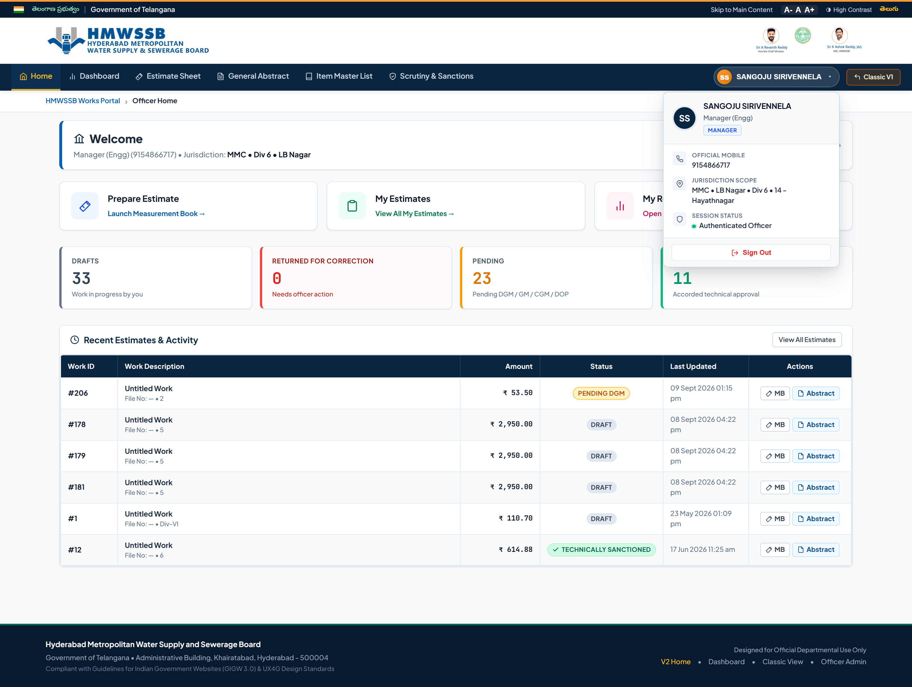
</p>

---

### Stage 2: Executive Dashboard & Live Registry

#### 4. Executive Works Dashboard
Comprehensive executive analytics screen showcasing high-level financial KPIs, processing volume counters, multi-criteria filters, and real-time estimate status registry.
- **Source**: [`dashboard-v2.html`](file:///e:/works/dashboard-v2.html)
- **Features**: Metric counters (*Total Estimates*, *Pending Technical Scrutiny*, *Sanctioned Capital Value in ₹*, *SSR Master Catalog Items*), search-as-you-type filter, and status filter dropdowns.

<p align="center">
  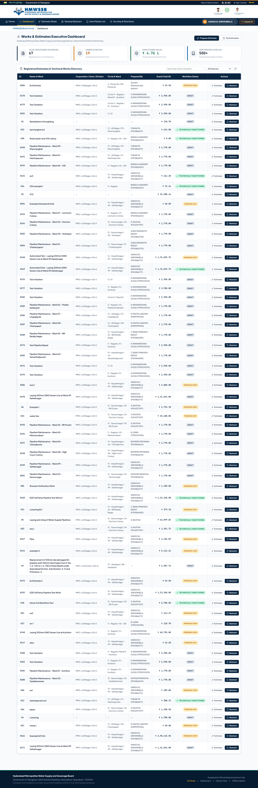
</p>

#### 5. My Estimates Directory & Status Registry
Searchable and filterable registry listing all estimates scoped to the logged-in officer's geographical territory, complete with official GIGW status badges and direct action buttons.
- **Source**: [`estimates-v2.html`](file:///e:/works/estimates-v2.html)
- **Features**: Scoped listing, dynamic status badges (*Draft*, *Submitted to DGM/GM/CGM/DOP*, *Technically Sanctioned*), and instant navigation to MB or Abstract.

<p align="center">
  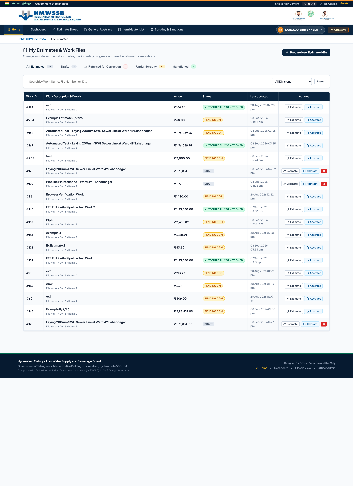
</p>

---

### Stage 3: Measurement Book (MB) Entry & SSR Engine

#### 6. Measurement Sheet (Blank Entry Form)
The foundational entry form for civil engineers to initiate new works. Features cascading geographical selection menus (Corporation $\rightarrow$ Zone $\rightarrow$ Division $\rightarrow$ Circle $\rightarrow$ Ward) and an empty Measurement Book grid.
- **Source**: [`measurement-v2.html`](file:///e:/works/measurement-v2.html)
- **Features**: Dynamic ward cascade, work title specification, GST rate selection, and dimensional data table.

<p align="center">
  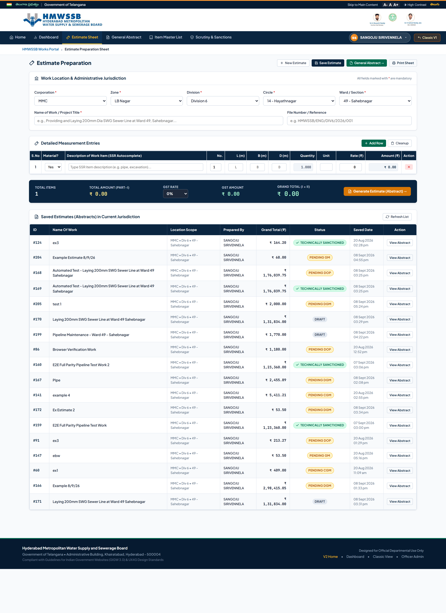
</p>

#### 7. Live Multi-Token SSR Autocomplete Search
High-speed fuzzy search engine querying the Standard Schedule of Rates master database. As the engineer types, the system matches words anywhere in the item description and populates rates and units instantly.
- **Source**: [`measurement-v2.html`](file:///e:/works/measurement-v2.html) | [`app-v2.js`](file:///e:/works/app-v2.js)
- **Features**: Debounced 300ms multi-word SQL search specification, matching items regardless of word order, sub-second latency.

<p align="center">
  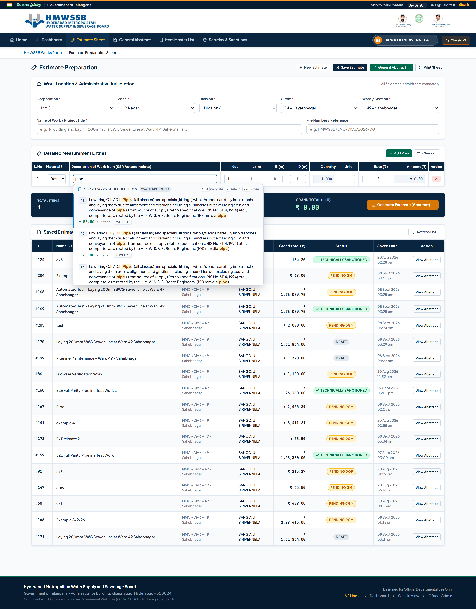
</p>

#### 8. Loaded Measurement Book with Dimensional Calculations
A fully populated Measurement Book displaying multiple line items, calculated quantities ($N \times L \times B \times D$), unit rates, line totals, and automatic Civil vs. Material classification.
- **Source**: [`measurement-v2.html`](file:///e:/works/measurement-v2.html?id=148)
- **Features**: Add row, duplicate row, remove row, automatic total calculation, and direct transition to General Abstract.

<p align="center">
  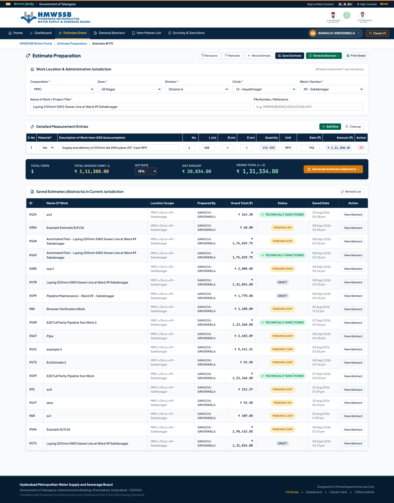
</p>

---

### Stage 4: General Abstract & Financial Breakdown

#### 9. General Abstract & Financial Classification
The official financial abstract dividing project expenses into **Part-I** (Civil Works and Material Supplies), **Part-II** (State & Central GST), and **Part-III** (Lump Sum Unforeseen Provisions), culminating in the official Grand Total and Indian currency words conversion.
- **Source**: [`abstract-v2.html`](file:///e:/works/abstract-v2.html?id=148)
- **Features**: Live GST adjustment, unforeseen contingency additions, round-off computations, and print-ready executive summary format.

<p align="center">
  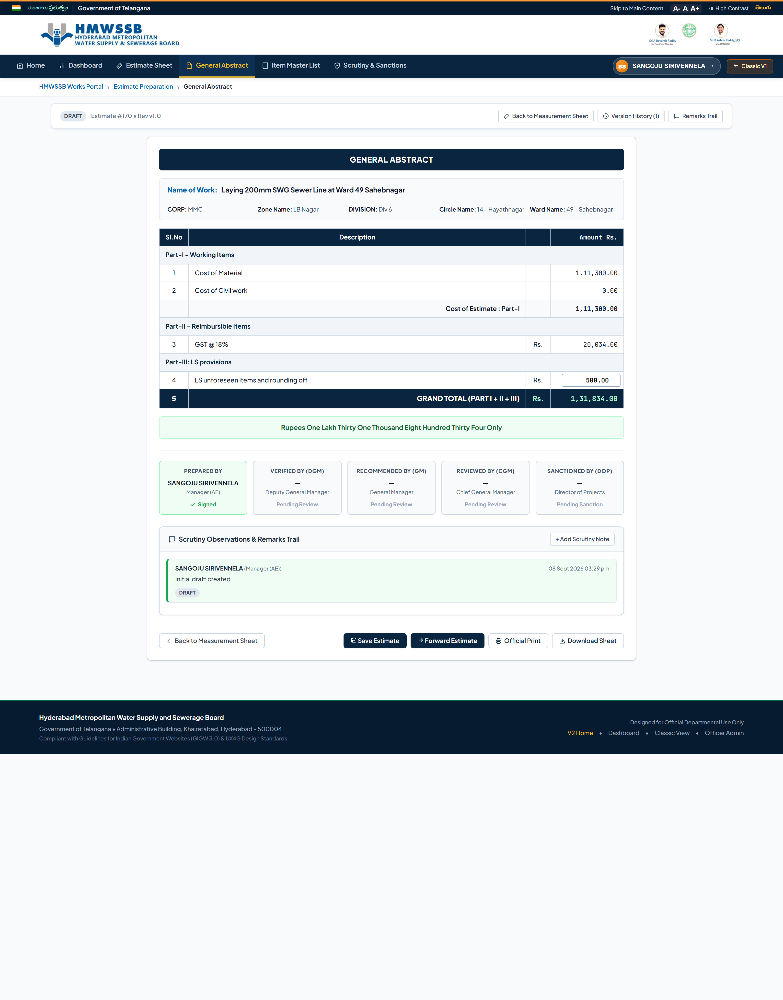
</p>

#### 10. Workflow Action & Forward Modal
Modal dialog launched from the General Abstract when a drafting engineer or scrutinizing officer is ready to forward the file to the next hierarchical level.
- **Source**: [`abstract-v2.html`](file:///e:/works/abstract-v2.html)
- **Features**: Automatic next-officer resolution, optional forwarding notes, confirmation prompt, and instantaneous state update.

<p align="center">
  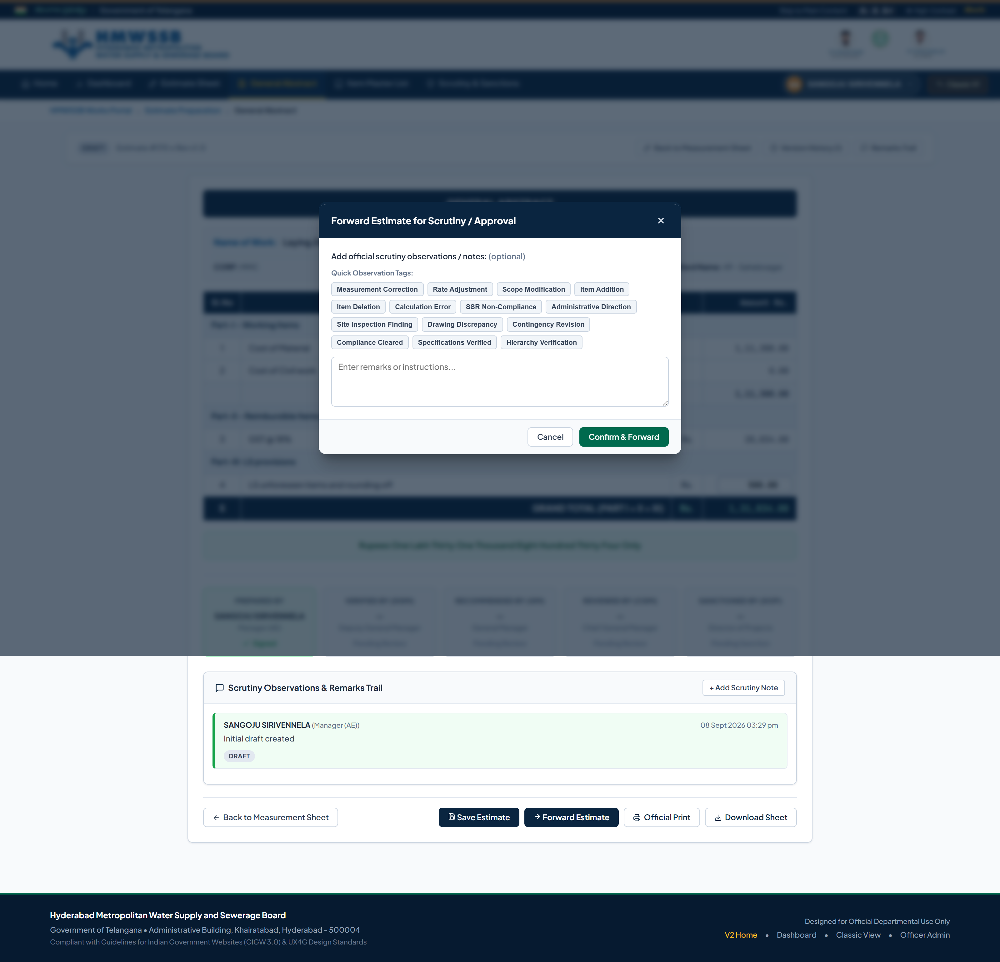
</p>

---

### Stage 5: Technical Scrutiny & Sanctions Queue

#### 11. Technical Scrutiny & Sanctions Desk
Dedicated scrutiny inbox used by **Deputy General Managers (DGM)**, **General Managers (GM)**, **Chief General Managers (CGM)**, and the **Director of Projects (DOP)** to inspect, review, and act upon pending submissions.
- **Source**: [`approvals-v2.html`](file:///e:/works/approvals-v2.html)
- **Features**: Filter by pending action, quick review drawer, visual diff inspection, and one-click forward/return triggers.

<p align="center">
  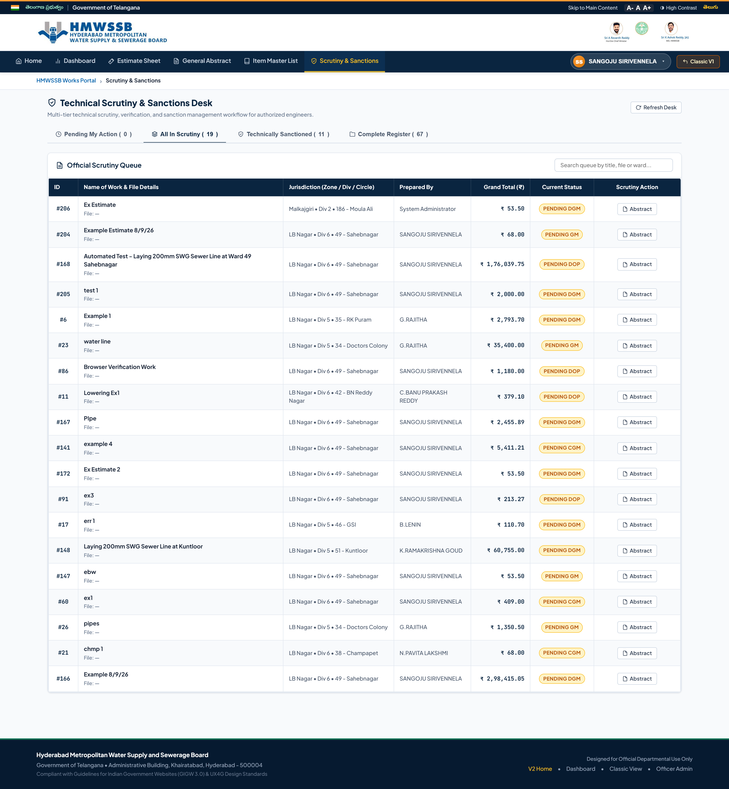
</p>

#### 12. Scrutiny Endorsement & Forward Modal
High-level verification modal for scrutinizing officers to formally record their review remarks before advancing the file to the next tier of authority.
- **Source**: [`approvals-v2.html`](file:///e:/works/approvals-v2.html)
- **Features**: Captures verified by / recommended by signatures, timestamps, and forward endorsement notes.

<p align="center">
  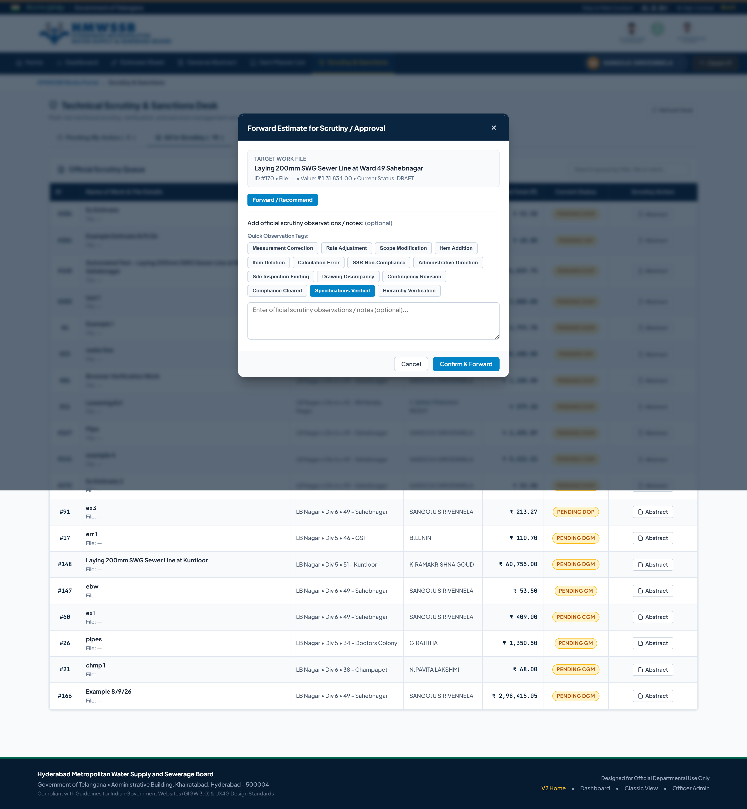
</p>

#### 13. Scrutiny Return & Query Tags Modal
Formal return dialogue utilized when a scrutinizing officer finds a defect or query in the measurements, SSR rates, or specifications. The estimate is safely returned to the previous desk or original drafter.
- **Source**: [`approvals-v2.html`](file:///e:/works/approvals-v2.html)
- **Features**: Mandatory query categorization tags (`SSR_RATE_DISCREPANCY`, `MEASUREMENT_QUERY`, `SPECIFICATION_CHANGE`, `SITE_VERIFICATION`), mandatory remarks field, and status reversion to `DRAFT`.

<p align="center">
  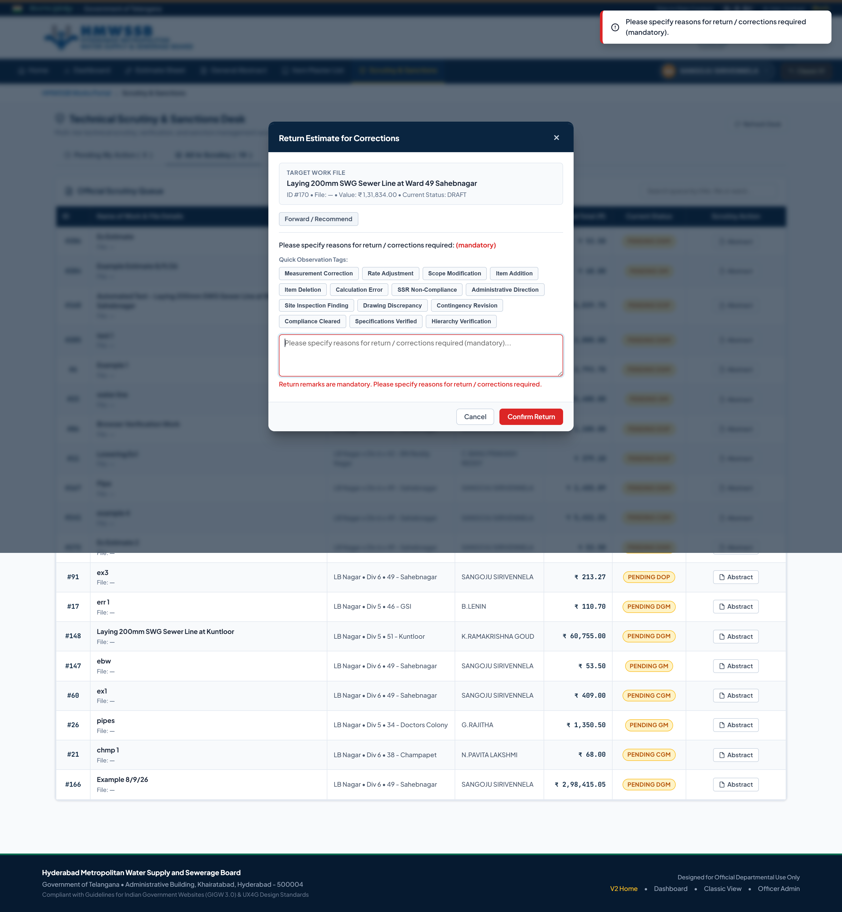
</p>

---

### Stage 6: Master Schedules, Reports & Administration

#### 14. Standard Schedule of Rates (SSR) Master Catalog
Comprehensive reference catalog of all approved standard civil and electrical works items, standardized units of measurement (Meter, Cum, Sqm, Each), and board-sanctioned rates.
- **Source**: [`ssr-v2.html`](file:///e:/works/ssr-v2.html)
- **Features**: Search bar, category filter, unit rate inspection, and direct copying of standard item specifications.

<p align="center">
  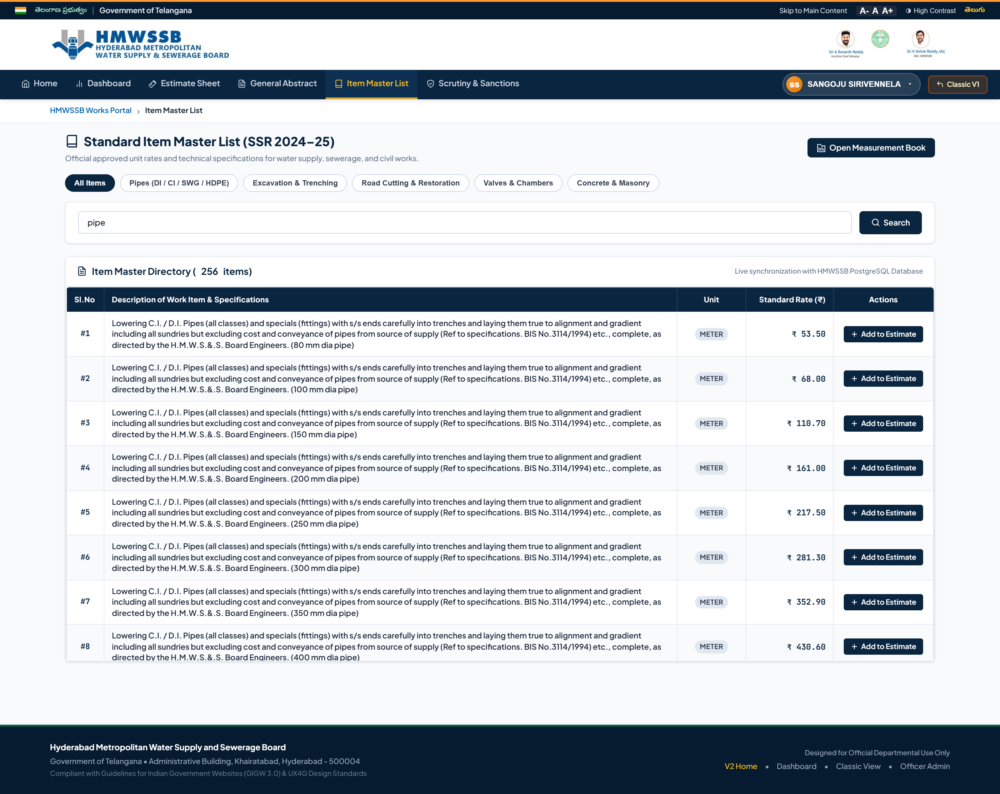
</p>

#### 15. Reports & Technical Audit Pipeline
System-wide transparency and audit report screen presenting processing timelines, divisional velocity, approval rates, and chronological administrative audit logs.
- **Source**: [`reports-v2.html`](file:///e:/works/reports-v2.html)
- **Features**: Turnaround time metrics, division-wise pipeline tracking, and full immutable audit trail records with IP address tracking.

<p align="center">
  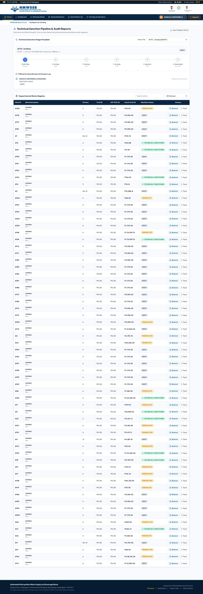
</p>

#### 16. System Administration & Officer Directory
Centralized administrative console for managing board engineers, provisioning login credentials, assigning official roles, and managing jurisdiction boundaries.
- **Source**: [`admin-v2.html`](file:///e:/works/admin-v2.html)
- **Features**: Officer directory search, role assignment, active location listing, and user account creation.

<p align="center">
  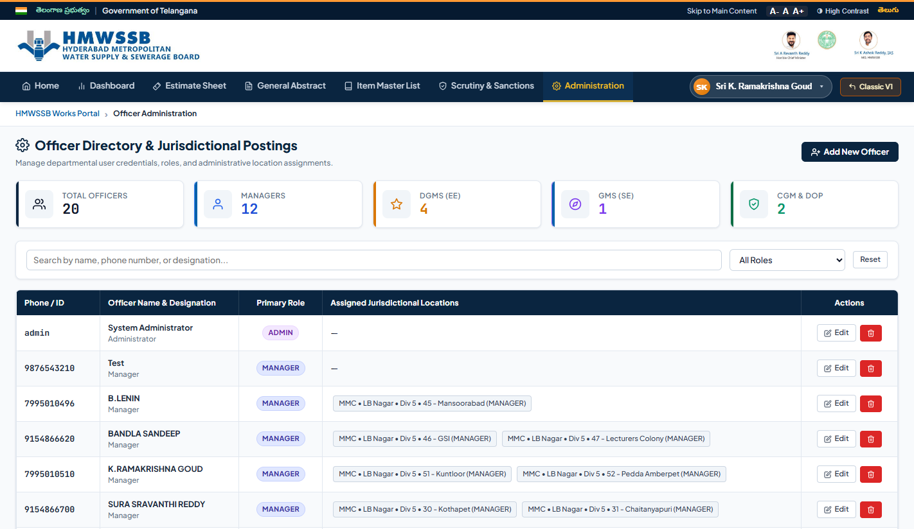
</p>

#### 17. Officer Assignment & Multi-Jurisdiction Modal
Administrative modal dialog allowing superusers to map an engineer to one or multiple municipal corporations, zones, divisions, circles, and wards.
- **Source**: [`admin-v2.html`](file:///e:/works/admin-v2.html)
- **Features**: Multi-location mapping, role assignment per jurisdiction, and live database sync.

<p align="center">
  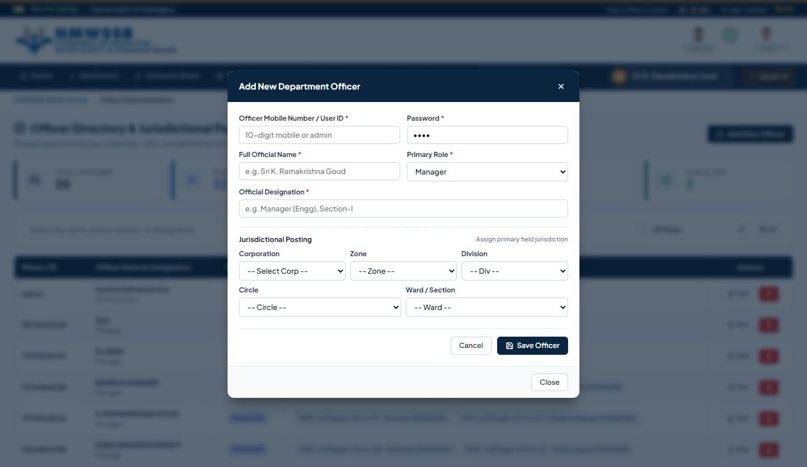
</p>

---

## 🏗️ System Architecture & Workflows

### High-Level Architecture

The platform employs a clean **3-Tier Architecture** integrating a lightweight, dependency-free responsive Single Page Application frontend with an enterprise Spring Boot REST API and PostgreSQL relational storage.

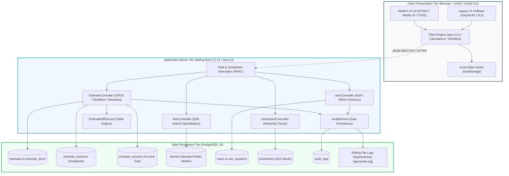

---

### Technical Sanction Finite State Machine (FSM)

The lifecycle of an estimate is governed by a strict **Finite State Machine**. Only designated roles within matching geographical boundaries can trigger state transitions.

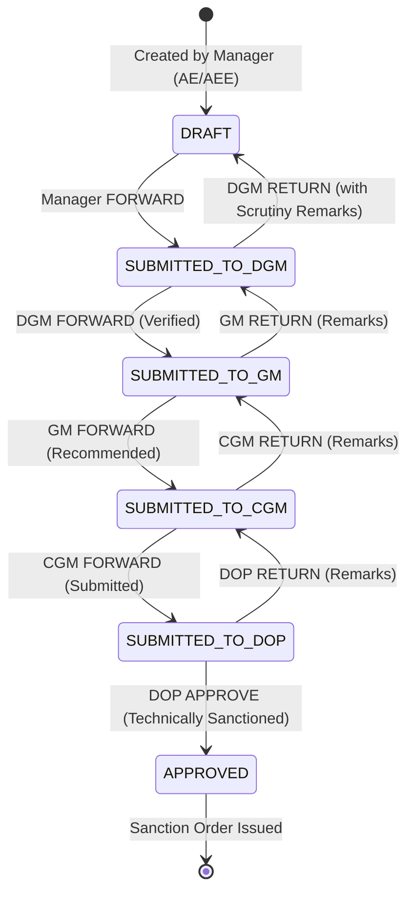

---

### End-to-End Estimate Lifecycle Sequence

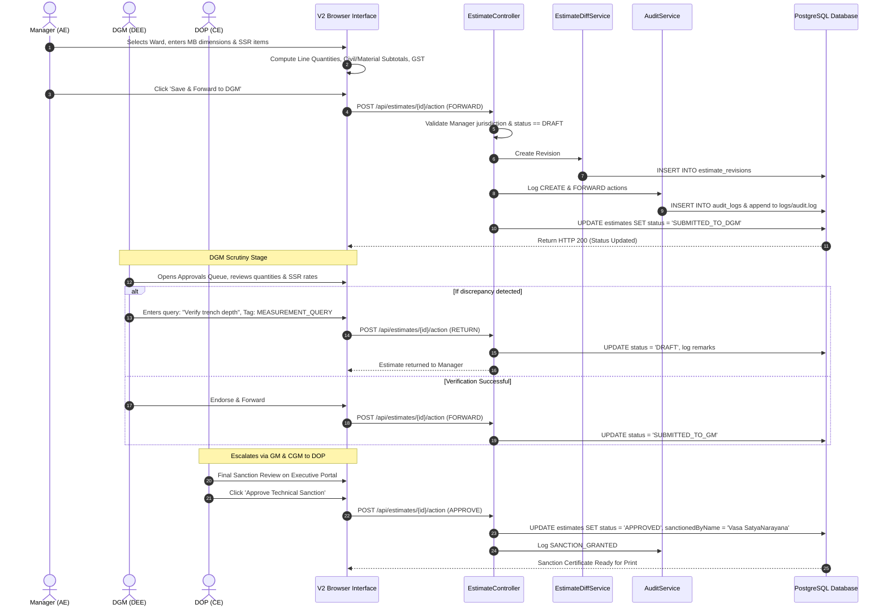

---

## 🗺️ Administrative & Geographical Hierarchy

The Hyderabad metropolitan operational territory is organized into a **5-tier cascading geographic hierarchy**. The system parses this directly from the GIS dataset into `jurisdictions.json` and enforces validation at both client and database levels.

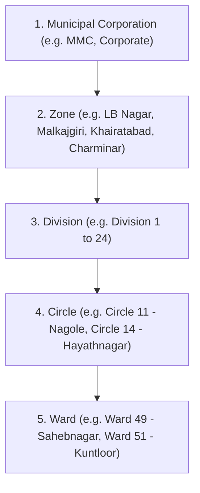

### Hierarchy Breakdown & Jurisdiction Coverage
- **Corporation (`corp`)**: High-level governing entity (e.g., `MMC`, `Corporate`).
- **Zone (`zone_name`)**: 8 Regional engineering zones across Hyderabad.
- **Division (`division`)**: 24 Operational divisions headed by General Managers (EE).
- **Circle (`circle_name`)**: Sub-divisional units supervised by Deputy General Managers (DEE).
- **Ward (`ward_name`)**: 150+ Municipal wards managed by field Managers (AE/AEE).

> [!NOTE]
> When an officer accesses estimates, the backend automatically constrains the query based on their assigned role and geographical scope. A Manager assigned to Ward 51 cannot view or modify estimates originating in Ward 52.

---

## 👥 Role Hierarchy & Authority Matrix

The system implements a rigid governance matrix reflecting the official administrative protocol of HMWSSB:

| Role Code | Official Designation | Rank Level | Operational Scope | Permitted Actions |
|:---|:---|:---:|:---|:---|
| **`MANAGER`** | Manager (Engineering) / AE / AEE | Level 1 | Specific Ward & Circle | Create estimate, edit Draft, calculate MB, Forward to DGM |
| **`DGM`** | Deputy General Manager / DEE | Level 2 | Specific Circle | Scrutinize MB items, Forward to GM, Return to Manager with remarks |
| **`GM`** | General Manager / EE | Level 3 | Complete Division | Technical audit, verify rates, Forward to CGM, Return to DGM |
| **`CGM`** | Chief General Manager / SE | Level 4 | Complete Zone | Financial & scope review, Forward to DOP, Return to GM |
| **`DOP`** | Director of Projects / CE | Level 5 | Board-wide (Corporate) | **Final Technical Sanction Authority (`APPROVED`)**, Return to CGM |
| **`ADMIN`** | System Administrator | Superuser | Global / All Portals | Manage users, configure SSR rates, override lockouts, view audits |

---

## 📐 Engineering & Financial Calculation Formulae

The estimation mathematical model guarantees **100% parity** between the client-side JavaScript engine ([`app-v2.js`](file:///e:/works/app-v2.js)) and the backend Java persistence layer ([`EstimateController.java`](file:///e:/works/src/main/java/com/hmwssb/works/controller/EstimateController.java)).

### 1. Dimensional Measurement Book (MB) Formula
For each line item $i$, the quantity $Q_i$ is calculated from physical dimensions:
$$Q_i = N_i \times L_i \times B_i \times D_i$$
Where:
- $N_i$ = Multiplier / Number of units (defaults to $1.0$ if unspecified).
- $L_i$ = Length in meters.
- $B_i$ = Breadth in meters.
- $D_i$ = Depth / Height in meters.
- *Fallback*: If dimensional attributes are blank, the manual quantity input is utilized.

### 2. Item Amount
$$\text{Amount}_i = \text{Round}\left(Q_i \times R_i, 2\right)$$
Where $R_i$ is the unit rate derived from the Standard Schedule of Rates (SSR).

### 3. Part-I: Basic Cost of Work
Line items are automatically classified into Civil Works or Material Supplies based on the item category or the `isMaterial` flag:
$$\text{Cost of Civil Work} = \sum_{i \in \text{Civil}} \text{Amount}_i$$
$$\text{Cost of Material} = \sum_{i \in \text{Material}} \text{Amount}_i$$
$$\text{Part-I Total} = \text{Cost of Civil Work} + \text{Cost of Material}$$

### 4. Part-II: Goods and Services Tax (GST)
$$\text{GST Amount} = \text{Round}\left(\text{Part-I Total} \times \frac{\text{GST \%}}{100}, 2\right)$$
*(Default board GST rate is $18.0\%$)*

### 5. Part-III: Provisions & Lump Sum Unforeseen
$$\text{Part-III Total} = \text{Unforeseen LS Amount}$$

### 6. Grand Total
$$\mathbf{\text{Grand Total}} = \text{Part-I Total} + \text{GST Amount} + \text{Part-III Total}$$

---

## 🗄️ Database Schema & Entity Models

The application persists data to **PostgreSQL 16** via Hibernate ORM / Spring Data JPA.

```mermaid
erDiagram
    estimates ||--o{ estimate_items : "contains (1 to N, Cascade Delete)"
    estimates ||--o{ estimate_revisions : "tracks version snapshots"
    estimates ||--o{ estimate_remarks : "threaded scrutiny trail"
    users ||--o{ user_locations : "assigned geographical jurisdictions"
    
    estimates {
        INTEGER id PK "Auto-increment IDENTITY"
        VARCHAR name_of_work "Title of the project"
        DOUBLE gst_percent "GST rate (e.g. 18.0)"
        DOUBLE grand_total "Computed total cost"
        DOUBLE unforeseen_amount "Part-III LS provision"
        VARCHAR corp "Corporation name"
        VARCHAR zone_name "Zone name"
        VARCHAR division "Division identifier"
        VARCHAR circle_name "Circle name"
        VARCHAR ward_name "Ward name"
        VARCHAR officer_phone "Owner / Drafter phone"
        VARCHAR status "DRAFT, SUBMITTED_TO_DGM, etc."
        VARCHAR prepared_by_name "Manager signature"
        VARCHAR verified_by_name "DGM signature"
        VARCHAR recommended_by_name "GM signature"
        VARCHAR forwarded_by_name "CGM signature"
        VARCHAR sanctioned_by_name "DOP signature"
        BIGINT version "Optimistic Locking (@Version)"
        TIMESTAMP created_at "Creation timestamp"
    }

    estimate_items {
        INTEGER id PK "Auto-increment IDENTITY"
        INTEGER estimate_id FK "Parent estimate ID"
        INTEGER sno "Sequence number"
        VARCHAR is_material "Yes / No"
        TEXT description "Line item description"
        DOUBLE num "Multiplier"
        DOUBLE length "Length (m)"
        DOUBLE breadth "Breadth (m)"
        DOUBLE depth "Depth (m)"
        DOUBLE quantity "Computed quantity"
        DOUBLE rate "Unit rate (from SSR)"
        VARCHAR unit "Unit (Meter, Cum, Each)"
        DOUBLE amount "Row amount (Qty * Rate)"
    }

    estimate_revisions {
        BIGINT id PK "Auto-increment IDENTITY"
        INTEGER estimate_id "Target estimate"
        INTEGER revision_number "Incremental revision index"
        VARCHAR revision_type "INITIAL_DRAFT, MODIFICATION, RESTORE"
        VARCHAR status_at_revision "Status when snapshot was taken"
        TEXT snapshot_json "Full serialized Estimate entity"
        VARCHAR change_summary "Visual diff text"
        TIMESTAMP created_at "Timestamp"
    }

    estimate_remarks {
        BIGINT id PK "Auto-increment IDENTITY"
        INTEGER estimate_id "Target estimate"
        VARCHAR officer_phone "Commenting officer phone"
        VARCHAR officer_role "MANAGER, DGM, GM, CGM, DOP"
        VARCHAR action "FORWARD, RETURN, REVISION"
        VARCHAR from_status "Previous status"
        VARCHAR to_status "New status"
        VARCHAR remarks "Official scrutiny notes"
        VARCHAR tags "Taxonomical tag"
        TIMESTAMP created_at "Timestamp"
    }

    itemlist {
        INTEGER slno PK "Serial number"
        TEXT item_description "Authoritative SSR text"
        VARCHAR unit "Standard unit"
        DOUBLE rate "Official SSR rate"
    }

    users {
        VARCHAR phone_number PK "Unique phone number"
        VARCHAR name "Full officer name"
        VARCHAR designation "Official designation"
        VARCHAR role "PRIMARY role"
        VARCHAR password "Hashed / Encrypted credential"
    }

    user_locations {
        INTEGER id PK "Auto-increment IDENTITY"
        VARCHAR phone_number FK "User relationship"
        VARCHAR corp "Assigned Corporation"
        VARCHAR zone_name "Assigned Zone"
        VARCHAR division "Assigned Division"
        VARCHAR circle_name "Circle"
        VARCHAR ward_name "Ward"
        VARCHAR role "Role in this jurisdiction"
    }

    audit_logs {
        BIGINT id PK "Auto-increment IDENTITY"
        VARCHAR action "CREATE_ESTIMATE, FORWARD, etc."
        VARCHAR entity_type "Estimate, User"
        VARCHAR entity_id "Entity ID"
        VARCHAR officer_phone "Acting officer"
        VARCHAR officer_name "Officer name"
        VARCHAR previous_status "State before action"
        VARCHAR new_status "State after action"
        VARCHAR ip_address "Client IP address"
        TIMESTAMP timestamp "Timestamp"
    }
```

---

## 🔌 REST API Reference

The backend exposes a comprehensive RESTful JSON API under `/api`.

### 1. Estimates Management (`/api/estimates`)

| Method | Endpoint | Description | Auth / Role Scope |
|:---|:---|:---|:---|
| `POST` | `/api/estimates` | Create or update estimate. Performs optimistic lock check and auto-snapshots revision. | `MANAGER` (Draft), Scrutinizer at current status |
| `GET` | `/api/estimates` | List estimates scoped to officer's assigned jurisdiction. Supports search and status filters. | Any logged-in officer (Scoped) |
| `GET` | `/api/estimates/{id}` | Fetch full estimate with all line items and current signature state. | Jurisdiction-scoped |
| `DELETE`| `/api/estimates/{id}` | Delete estimate (allowed only for `DRAFT` status by creator or `ADMIN`). | Creator or `ADMIN` |
| `POST` | `/api/estimates/{id}/action` | Trigger workflow transitions (`FORWARD`, `RETURN`, `APPROVE`). | Authorized officer at stage |

#### Workflow Action Request Payload:
```json
{
  "action": "FORWARD",
  "officerPhone": "7995010510",
  "remarks": "Measurements verified against site conditions. Recommended for sanction.",
  "tags": "SITE_VERIFIED"
}
```

### 2. Revision Control & Diffs (`/api/estimates/{id}/revisions`)

| Method | Endpoint | Description |
|:---|:---|:---|
| `GET` | `/api/estimates/{id}/revisions` | Retrieve all revision snapshots for an estimate. |
| `GET` | `/api/estimates/{id}/revisions/{revNum}` | Retrieve full JSON snapshot of a specific revision. |
| `GET` | `/api/estimates/{id}/revisions/diff?revA=1&revB=2` | Compute detailed visual diff between two revisions. |
| `POST` | `/api/estimates/{id}/revisions/{revNum}/restore` | Rollback estimate to the specified previous revision snapshot. |

### 3. Scrutiny Remarks & Audit Trail (`/api/estimates/{id}/remarks`)

| Method | Endpoint | Description |
|:---|:---|:---|
| `GET` | `/api/estimates/{id}/remarks` | Retrieve chronological scrutiny remarks trail with tags. |
| `POST` | `/api/estimates/{id}/remarks` | Append an intermediate observation note without advancing workflow. |

### 4. Standard Schedule of Rates (SSR) Master (`/api/items`)

| Method | Endpoint | Description |
|:---|:---|:---|
| `GET` | `/api/items/search?q={query}` | Multi-token case-insensitive search across SSR master item descriptions. |

#### Autocomplete Query Example:
`GET /api/items/search?q=Pipes+Lowering`
```json
[
  {
    "slno": 12,
    "itemDescription": "Lowering C.I. / D.I. Pipes in trenches including jointing...",
    "unit": "Meter",
    "rate": 150.00
  }
]
```

### 5. Administrative & User Authentication (`/api/users`)

| Method | Endpoint | Description |
|:---|:---|:---|
| `POST` | `/api/users/login` | Officer sign-in validating phone number and password. |
| `POST` | `/api/users/register` | Register new field engineer with multi-jurisdiction mappings. |
| `GET` | `/api/users` | Directory of all registered officers (Admin portal). |
| `GET` | `/api/jurisdictions/hierarchy` | Complete cascading tree of Corporation $\rightarrow$ Ward mappings. |

---

## 📂 Repository Directory Structure

```text
E:\works\
│   pom.xml                                  # Maven project configuration (Java 21, Spring Boot 3.5.14)
│   mvnw / mvnw.cmd                          # Maven 3.9.15 distribution wrapper scripts
│   application.properties                   # PostgreSQL datasource & Hibernate configuration
│   users_parsed.json                        # Official officer roster with jurisdiction profiles
│   jurisdictions.json                       # Hyderabad municipal geographical boundary dataset
│   clean_and_copy_json.ps1                  # Data synchronization automation script
│   codebase_diagrams.md                     # Deep architectural diagrams documentation
│   V2_UI_REVIEW.md                          # UI screen inventory, component tokens & review specs
│
├───assets/                                  # Static branding & visual assets
│   ├───images/                              # Seals, logos, and UI screenshot captures
│   └───v2-screenshots/                      # High-resolution V2 screen documentation images (01 to 17)
│
├───src/main/java/com/hmwssb/works/
│   │   WorksApplication.java                # Spring Boot application entry point
│   │
│   ├───config/
│   │       WebConfig.java                   # HTTP caching headers & security interceptors
│   │
│   ├───controller/
│   │       EstimateController.java          # REST endpoints for estimates, actions, revisions & diffs
│   │       ItemController.java              # SSR item autocomplete and search specification
│   │       JurisdictionController.java      # Geographical hierarchy and ward endpoints
│   │       UserController.java              # Authentication, user directory and location mappings
│   │       HomeController.java              # Default web route redirector
│   │       GlobalExceptionHandler.java      # Centralized error handler & status mapping
│   │
│   ├───model/
│   │       Estimate.java                    # Master estimate entity with @Version optimistic locking
│   │       EstimateItem.java                # Line-item dimensional measurement entity
│   │       EstimateRevision.java            # Immutable point-in-time JSON snapshot entity
│   │       EstimateRemark.java              # Chronological scrutiny remarks trail entity
│   │       Item.java                        # Standard Schedule of Rates (SSR) master entity
│   │       Jurisdiction.java                # Municipal administrative division entity
│   │       User.java                        # Officer authentication profile entity
│   │       UserLocation.java                # Geographical jurisdiction assignment entity
│   │       AuditLog.java                    # Enterprise audit event record entity
│   │
│   ├───repository/
│   │       EstimateRepository.java          # Estimate JPA repository with scoped query specifications
│   │       EstimateRevisionRepository.java  # Snapshot retrieval and version query repository
│   │       EstimateRemarkRepository.java    # Scrutiny remarks query repository
│   │       ItemRepository.java              # Multi-word LIKE specification query repository
│   │       JurisdictionRepository.java      # Geographical boundary repository
│   │       UserRepository.java              # Officer directory repository
│   │       AuditLogRepository.java          # Audit trail repository
│   │
│   ├───seeder/
│   │       DatabaseSeeder.java              # Automatic bootloader for users, wards & baseline revisions
│   │
│   └───service/
│           AuditService.java                # Dual-channel audit logger (PostgreSQL + rolling file)
│           EstimateDiffService.java         # Visual diff and change summary calculation engine
│
├───src/main/resources/
│   │   application.properties               # PostgreSQL datasource & JPA configuration
│   │   logback-spring.xml                   # Dual rolling file appender configuration (200MB/500MB)
│   │   jurisdictions.json                   # Classpath geographical dataset
│   │   users_parsed.json                    # Classpath officer directory dataset
│   │
│   └───static/                              # Modern V2 Web Interface (UX4G / GIGW 3.0)
│       │   login-v2.html                    # Officer Sign-In Portal with fast-role switcher
│       │   home-v2.html                     # Executive Home Portal with action launchpads
│       │   dashboard-v2.html                # Executive Works Dashboard with live KPIs
│       │   estimates-v2.html                # Scoped Estimates Directory & Status Registry
│       │   measurement-v2.html              # Measurement Sheet Entry & SSR Autocomplete
│       │   abstract-v2.html                 # General Abstract Financial Breakdown & Routing Modal
│       │   approvals-v2.html                # Technical Scrutiny & Sanctions Desk
│       │   ssr-v2.html                      # SSR Master Rate Schedule Catalog
│       │   reports-v2.html                  # Reports & Technical Audit Pipeline
│       │   admin-v2.html                    # System Administration & Officer Directory
│       │   app-v2.js                        # Unified Client Engine (Auth, Calculations, Workflow, API)
│       │   hierarchy.js                     # Geographical hierarchy fallback dataset
│       │
│       └───styles/
│               theme-v2.css                 # Government of Telangana design system tokens (GIGW 3.0)
│
└───src/test/java/com/hmwssb/works/
        WorksApplicationTests.java           # Integration test suite validating workflows and scoping
```

---

## 🚀 Setup & Installation Guide

### Prerequisites
- **Java SE Development Kit (JDK)**: Version **21 LTS** or later (Oracle OpenJDK or Eclipse Temurin).
- **Relational Database**: **PostgreSQL 16** (or PostgreSQL 14+).
- **Build Tool**: Apache **Maven 3.9+** *(Bundled wrapper `./mvnw` provided)*.
- **Web Browser**: Any modern evergreen browser (Google Chrome, Mozilla Firefox, Microsoft Edge).

### 1. Clone & Navigate to Repository
```bash
git clone https://github.com/your-org/hmwssb-works.git
cd hmwssb-works
```

### 2. Configure Database
Create a database named `postgres` (or `Works`) in PostgreSQL via `psql` or pgAdmin:
```sql
CREATE DATABASE postgres;
```

Update your database credentials in [`src/main/resources/application.properties`](file:///e:/works/src/main/resources/application.properties):
```properties
spring.datasource.url=jdbc:postgresql://localhost:5432/postgres
spring.datasource.username=postgres
spring.datasource.password=your_secure_password
spring.jpa.hibernate.ddl-auto=update
```

### 3. Build & Run Application
You can run the application directly using the bundled Maven wrapper:

#### On Windows (PowerShell / Command Prompt):
```powershell
.\mvnw.cmd spring-boot:run
```

#### On Linux / macOS:
```bash
chmod +x ./mvnw
./mvnw spring-boot:run
```

### 4. Automatic Database Seeding
Upon first startup, `DatabaseSeeder.java` will automatically:
- Seed **150+ administrative jurisdictions** from `jurisdictions.json`.
- Populate **50+ official user accounts** across all roles from `users_parsed.json`.
- Create a default superuser account: `admin` / `admin`.
- Generate baseline Revision 1 snapshots for all existing estimates.

### 5. Access the Portals
Open your browser and navigate to:
- **V2 Officer Portal**: [`http://localhost:8080/login-v2.html`](http://localhost:8080/login-v2.html)
- **Executive Dashboard**: [`http://localhost:8080/dashboard-v2.html`](http://localhost:8080/dashboard-v2.html)
- **SSR Catalog**: [`http://localhost:8080/ssr-v2.html`](http://localhost:8080/ssr-v2.html)
- **Admin Directory**: [`http://localhost:8080/admin-v2.html`](http://localhost:8080/admin-v2.html)

---

## 🧪 Testing & Quality Assurance

The codebase includes an automated integration test suite in [`WorksApplicationTests.java`](file:///e:/works/src/test/java/com/hmwssb/works/WorksApplicationTests.java) validating:
1. Multi-word SSR fuzzy search specifications.
2. End-to-end multi-role sanction workflow progression (Manager $\rightarrow$ DGM $\rightarrow$ GM $\rightarrow$ CGM $\rightarrow$ DOP).
3. Role-specific geographical boundary query validation.
4. Concurrency conflict detection via `@Version` optimistic locking.
5. Unicode encoding tolerance (such as en-dash `–` and non-breaking spaces).

### Execute Test Suite:
```powershell
.\mvnw.cmd test
```

---

## 🔒 Dual-Channel Audit Trail & Concurrency Safeguards

### 1. Dual-Channel Audit Logging (`AuditService`)
Every critical action in the system is synchronously logged to two independent channels:
1. **Relational Database Table (`audit_logs`)**: Searchable via the Reports & Audit portal.
2. **Rolling File Appender (`logs/audit.log`)**: High-speed appending configured via `logback-spring.xml` with automatic daily rotation, 90-day retention, and a 500MB size cap.

```log
2026-10-29 11:42:01.304 [http-nio-8080-exec-4] INFO  c.h.w.audit - ACTION=FORWARD ENTITY=Estimate/148 OFFICER=K.RAMAKRISHNA GOUD/7995010510(MANAGER) STATUS=DRAFT→SUBMITTED_TO_DGM DETAILS="Draft estimate completed for Ward 51" IP=127.0.0.1
```

### 2. Optimistic Concurrency Control (`@Version`)
To prevent overwrite hazards when multiple engineers review the same estimate:
- The `Estimate` entity includes a `@Version Long version` attribute.
- If Officer A and Officer B open an estimate simultaneously, Officer A's save increments the version from `1` to `2`.
- When Officer B attempts to submit changes based on version `1`, the server returns `HTTP 409 CONFLICT`:
  > *"This estimate was just modified by another officer. Please refresh and try again."*

---

## 🔑 Demo Accounts & Quick Access

For rapid local testing and verification, the following pre-seeded test accounts can be used (Default password: `1234`):

| Role | Officer Name | Phone Number | Jurisdiction Scope |
|:---|:---|:---:|:---|
| **`MANAGER`** | K.RAMAKRISHNA GOUD | `7995010510` | MMC $\rightarrow$ LB Nagar $\rightarrow$ Div 5 $\rightarrow$ Circle 11 $\rightarrow$ Ward 51 |
| **`DGM`** | T.N SAINATH GOUD | `7331185790` | MMC $\rightarrow$ LB Nagar $\rightarrow$ Div 5 $\rightarrow$ Circle 11 (Nagole) |
| **`GM`** | M.MAHENDER | `9989994708` | MMC $\rightarrow$ LB Nagar $\rightarrow$ Divisions 5 & 6 |
| **`CGM`** | P.NAGENDRA KUMAR | `9989989507` | MMC $\rightarrow$ LB Nagar Zone |
| **`DOP`** | Vasa SatyaNarayana | `9989999753` | Corporate $\rightarrow$ Board-wide Authority |
| **`ADMIN`** | System Administrator | `admin` *(pwd: `admin`)*| Board-wide Superuser |

> [!TIP]
> On the **Officer Sign-In Portal** ([`login-v2.html`](file:///e:/works/login-v2.html)), you can click the colored **Role Chips** at the bottom of the login card to immediately authenticate as any of these roles without typing credentials.

---

## 🛡️ Compliance, Security & Production Deployment

### 1. GIGW 3.0 & UX4G Compliance
- **Typography & Scale**: Standardized system font stack (`Inter`, `Segoe UI`, `Noto Sans Telugu`).
- **Color Contrast**: Complies with WCAG 2.1 AA standards (Navy `#0B3B60`, Saffron `#FF9933`, Green `#138808`).
- **Responsive Layout**: Fluid breakpoints supporting desktops, tablets, and field mobile devices.

### 2. Production Security Hardening
Before deploying to production government cloud (e.g., SDC / NIC / AWS GovCloud):
1. **Restrict CORS**: Update `@CrossOrigin(origins = "https://works.hmwssb.telangana.gov.in")` in all REST controllers.
2. **Password Encryption**: Activate Spring Security BCryptPasswordEncoder for officer credentials.
3. **HTTPS / TLS 1.3**: Terminate SSL at the reverse proxy (Nginx / HAProxy) with HSTS enabled.
4. **Environment Variables**: Externalize database credentials:
   ```bash
   export SPRING_DATASOURCE_URL="jdbc:postgresql://db.internal:5432/works"
   export SPRING_DATASOURCE_USERNAME="prod_works_user"
   export SPRING_DATASOURCE_PASSWORD="<vault-managed-secret>"
   ```

---

<div align="center">

**HMWSSB Works Management & Technical Sanction System (V2)**  
*Developed for the Hyderabad Metropolitan Water Supply and Sewerage Board*  
*Government of Telangana*

</div>
