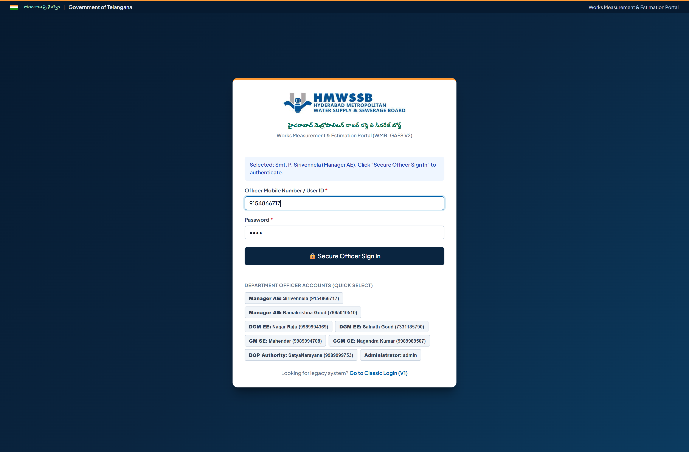
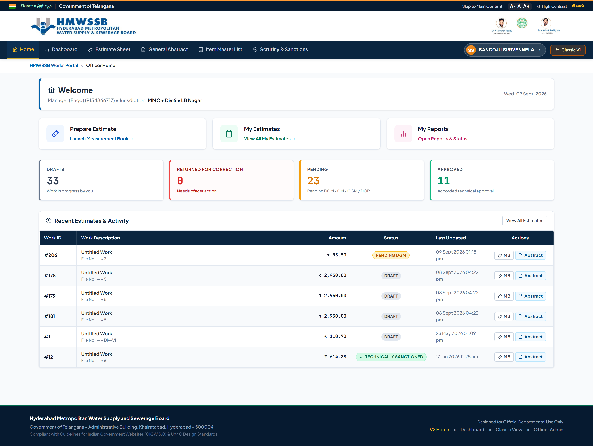

# 🏛️ HMWSSB Works Management & Estimation System (V2)
## Visual UI Review, Component Inventory & Change Specifications Guide

> **Document Purpose**: This document provides a complete visual record of all **13 screens and modal workflows** in the modern **V2 UI**, paired with a technical inventory of the exact source files, lines, and CSS selectors where changes can be made.
> 
> ✍️ **How to Use**: Under each screen section, there is a designated **"Officer / User Feedback & Requested Changes"** block. Add your comments, design modifications, or feature requests directly into those blocks!

---

## 📑 Table of Contents
1. [Screen 1: Officer Sign-In Portal (`login-v2.html`)](#screen-1-officer-sign-in-portal-login-v2html)
2. [Screen 2: Officer Home Portal (`home-v2.html`)](#screen-2-officer-home-portal-home-v2html)
3. [Screen 3: Executive Works Dashboard (`dashboard-v2.html`)](#screen-3-executive-works-dashboard-dashboard-v2html)
4. [Screen 4: My Estimates Directory (`estimates-v2.html`)](#screen-4-my-estimates-directory-estimates-v2html)
5. [Screen 5: Estimate Preparation Sheet - Blank Form (`measurement-v2.html`)](#screen-5-estimate-preparation-sheet---blank-form-measurement-v2html)
6. [Screen 6: Estimate Preparation Sheet - Loaded Measurements (`measurement-v2.html?id=148`)](#screen-6-estimate-preparation-sheet---loaded-measurements-measurement-v2htmlid148)
7. [Screen 7: General Abstract & Financial Breakdown (`abstract-v2.html?id=148`)](#screen-7-general-abstract--financial-breakdown-abstract-v2htmlid148)
8. [Screen 8: Technical Scrutiny & Sanctions Queue (`approvals-v2.html`)](#screen-8-technical-scrutiny--sanctions-queue-approvals-v2html)
9. [Screen 9: SSR Standard Schedule of Rates Catalog (`ssr-v2.html`)](#screen-9-ssr-standard-schedule-of-rates-catalog-ssr-v2html)
10. [Screen 10: Reports & Technical Audit Pipeline (`reports-v2.html`)](#screen-10-reports--technical-audit-pipeline-reports-v2html)
11. [Screen 11: System Administration & Jurisdictions (`admin-v2.html`)](#screen-11-system-administration--jurisdictions-admin-v2html)
12. [Screen 12: Scrutiny Action & Verification Modal (`approvals-v2.html`)](#screen-12-scrutiny-action--verification-modal-approvals-v2html)
13. [Screen 13: Workflow Action & Scrutiny Tags Modal (`abstract-v2.html`)](#screen-13-workflow-action--scrutiny-tags-modal-abstract-v2html)
14. [Global Styles, Theme Tokens & Core Engine Reference](#global-styles-theme-tokens--core-engine-reference)

---

## Screen 1: Officer Sign-In Portal (`login-v2.html`)

### 📍 Where to Make Changes:
- **Primary Page Source**: [login-v2.html](file:///e:/works/login-v2.html) (and [src/main/resources/static/login-v2.html](file:///e:/works/src/main/resources/static/login-v2.html))
- **Card & Form Layout**: `login-v2.html` Lines 9–96 (scoped `<style>`) and Lines 112–187 (DOM structure)
- **Top Government Ribbon**: Lines 100–108 (`.gov-ribbon`, `Government of Telangana`)
- **Branding & Emblems**: Lines 114–128 (Logo `assets/images/hmwssb_logo.png`, board title in English & Telugu)
- **Sign-In Inputs & Button**: Lines 135–158 (`#phone`, `#password`, `#login-btn`)
- **Quick-Role Fast Select Chips**: Lines 162–187 (`.role-chips`, `.role-chip`)
- **Client Auth Logic**: Lines 191–290 (or [app-v2.js](file:///e:/works/app-v2.js) lines 31–105)

### 💡 Notable Observations & Potential Changes:
1. **Password Visibility**: Currently there is no reveal password toggle icon (eye icon).
2. **Quick Roles Layout**: Role chips can be grouped by rank hierarchy (AE -> EE -> SE -> CE -> DOP -> Admin).
3. **Background Styling**: Dark navy gradient (`#061A30` to `#0B3B60`) can be customized with watermarks or Telangana state patterns in line 14.

> ### 📝 Officer / User Feedback & Requested Changes:
> <!-- ADD YOUR COMMENTS OR CHANGES FOR SCREEN 1 HERE -->
> - [ ] 
> - [ ] 

---

## Screen 2: Officer Home Portal (`home-v2.html`)

### 📍 Where to Make Changes:
- **Primary Page Source**: [home-v2.html](file:///e:/works/home-v2.html) (and [src/main/resources/static/home-v2.html](file:///e:/works/src/main/resources/static/home-v2.html))
- **Officer Welcome Card & Jurisdiction**: Lines 21–32 (`.welcome-card`, `#disp-officer-name`, `#disp-officer-meta`, `#disp-financial-year`)
- **Launchpad Action Cards**: Lines 35–64 (Prepare Estimate, My Estimates, My Reports tiles)
- **Work Snapshot Counters**: Lines 67–98 (`#stat-drafts`, `#stat-returned`, `#stat-scrutiny`, `#stat-sanctioned`)
- **Recent Activity Table**: Lines 101–140 (`#recent-estimates-tbody`)
- **Styles**: [styles/theme-v2.css](file:///e:/works/styles/theme-v2.css) lines 350–520 (`.launch-card`, `.snapshot-card`)

### 💡 Notable Observations & Potential Changes:
1. **Fallback for Untitled Works**: For newly drafted works, the table shows "Untitled Work". We can auto-fallback to the first line-item description or "Draft Estimate #{id}".
2. **Action Icons in Table**: Action buttons show "MB" and "Abstract". Could add tooltips or quick-preview buttons.
3. **Counter Color Accents**: Saffron/Navy/Green GIGW styling on cards can be adjusted in CSS.

> ### 📝 Officer / User Feedback & Requested Changes:
> <!-- ADD YOUR COMMENTS OR CHANGES FOR SCREEN 2 HERE -->
> - [ ] 
> - [ ] 

---

## Screen 3: Executive Works Dashboard (`dashboard-v2.html`)

### 📍 Where to Make Changes:
- **Primary Page Source**: [dashboard-v2.html](file:///e:/works/dashboard-v2.html) (and [src/main/resources/static/dashboard-v2.html](file:///e:/works/src/main/resources/static/dashboard-v2.html))
- **Dashboard Header & Quick Actions**: Lines 16–33 (Title, "Prepare Estimate", "My Estimates" buttons)
- **KPI Metrics Grid**: Lines 36–71 (`.metrics-grid`, `#stat-total-count`, `#stat-pending-count`, `#stat-approved-value`, `#stat-ssr-count`)
- **Filter Controls**: Lines 74–91 (`#search-filter`, `#status-filter`, reset button)
- **Live Registry Table**: Lines 94–115 (`#estimates-table`, `#estimates-tbody`)
- **Table Rendering Script**: Lines 172–213 (`renderTable()`, status badges, currency formatting)

### 💡 Notable Observations & Potential Changes:
1. **Metric Tiles**: Four key metrics are displayed. Can add a 5th metric like "Average Processing Time" or "Pending Returned Works".
2. **Table Pagination / Sticky Header**: Large lists can be paginated (10/25/50 per page) with sticky column headers.
3. **Export to Excel**: A quick "Export Dashboard to Excel" button can be added in the filter bar.

> ### 📝 Officer / User Feedback & Requested Changes:
> <!-- ADD YOUR COMMENTS OR CHANGES FOR SCREEN 3 HERE -->
> - [ ] 
> - [ ] 

---

## Screen 4: My Estimates Directory (`estimates-v2.html`)

### 📍 Where to Make Changes:
- **Primary Page Source**: [estimates-v2.html](file:///e:/works/estimates-v2.html) (and [src/main/resources/static/estimates-v2.html](file:///e:/works/src/main/resources/static/estimates-v2.html))
- **Status Tabs**: Lines 33–50 (`.filter-tabs`, `#tab-all`, `#tab-drafts`, `#tab-returned`, `#tab-scrutiny`, `#tab-sanctioned`)
- **Search & Jurisdiction Filters**: Lines 53–64 (`#search-input`, `#division-filter`, reset button)
- **Estimates Table**: Lines 67–105 (`#estimates-table`, `#estimates-tbody`)
- **Row Deletion & Actions**: Lines 170–215 (`deleteEstimate(id)`, "Estimate", "Abstract", "Delete" buttons)

### 💡 Notable Observations & Potential Changes:
1. **Deletion Safety**: The red trash button directly triggers deletion. Adding a confirmation modal ("Are you sure you want to delete Estimate #ID?") prevents accidental loss of technical data.
2. **Returned for Correction Tab**: Highlight returned works in amber/red with remarks preview on mouse hover.
3. **Sort Indicators**: Clickable column headers (by Date, Amount, Status) with sort arrows.

> ### 📝 Officer / User Feedback & Requested Changes:
> <!-- ADD YOUR COMMENTS OR CHANGES FOR SCREEN 4 HERE -->
> - [ ] 
> - [ ] 

---

## Screen 5: Estimate Preparation Sheet - Blank Form (`measurement-v2.html`)

### 📍 Where to Make Changes:
- **Primary Page Source**: [measurement-v2.html](file:///e:/works/measurement-v2.html) (and [src/main/resources/static/measurement-v2.html](file:///e:/works/src/main/resources/static/measurement-v2.html))
- **Active Jurisdiction Bar**: Lines 31–43 (`#scope-badge-container`, `#scope-selector`)
- **Administrative Location Dropdowns**: Lines 50–92 (`#corp`, `#zone`, `#division`, `#circle`, `#ward`)
- **Work Title & File Reference**: Lines 94–105 (`#work-name`, `#file-number`)
- **Measurement Grid Structure**: Lines 112–148 (`#mb-table`, S.No, Material, Description, No, L, B, D, Quantity, Unit, Rate, Amount, Action)
- **Row Manipulation Controls**: Lines 115–120 (`+ Add Row`, `Cleanup`)
- **Real-Time Calculation Summary Bar**: Lines 150–188 (`#calc-total-items`, `#calc-part1`, `#calc-gst-rate`, `#calc-gst-amount`, `#calc-grand-total`)
- **Jurisdiction Saved Estimates List**: Lines 191–230 (`#local-saved-tbody`)

### 💡 Notable Observations & Potential Changes:
1. **Jurisdiction Auto-Populate**: Automatically locks and pre-selects according to the logged-in officer's posting.
2. **SSR Autocomplete Dropdown**: Styled with `.ssr-suggestion-list` in [styles/theme-v2.css](file:///e:/works/styles/theme-v2.css).
3. **Mandatory Field Indicators**: Red asterisks (*) are placed on required fields.

> ### 📝 Officer / User Feedback & Requested Changes:
> <!-- ADD YOUR COMMENTS OR CHANGES FOR SCREEN 5 HERE -->
> - [ ] 
> - [ ] 

---

## Screen 6: Estimate Preparation Sheet - Loaded Measurements (`measurement-v2.html?id=148`)

### 📍 Where to Make Changes:
- **Primary Page Source**: [measurement-v2.html](file:///e:/works/measurement-v2.html)
- **Lock Notice Banner**: Lines 45–48 (`#lock-notice-banner` when estimate is submitted to DGM/GM/Sanction)
- **Top Actions**: Lines 26–30 (`#btn-revisions`, `#btn-remarks`, `#btn-new-est`, `#btn-go-abstract`, `#btn-print`)
- **Data Rendering Logic**: Lines 310–450 (`renderMeasurements()`, input change listeners, row calculators)
- **CSS Column Widths**: [styles/theme-v2.css](file:///e:/works/styles/theme-v2.css) lines 600–680 (`.mb-table th`, `.mb-table td`, `.mb-table input`)

### ⚠️ CRITICAL Usability Issue Identified:
- **Dimension Column Text Clipping**: Look closely at columns **L (m)**, **B (m)**, **D (m)**, and **Amount (₹)**:
  - Length `150` is clipped to `"15"`.
  - Depth `1.5` is clipped to `"1."`.
  - Amount `₹ 47,250.00` is truncated on the right edge.
  - **Where to fix**: In [styles/theme-v2.css](file:///e:/works/styles/theme-v2.css), adjust `.mb-table input.num-input` min-width from `45px` to `65px`, and widen the Amount column from `110px` to `130px`.

> ### 📝 Officer / User Feedback & Requested Changes:
> <!-- ADD YOUR COMMENTS OR CHANGES FOR SCREEN 6 HERE -->
> - [ ] 
> - [ ] 

---

## Screen 7: General Abstract & Financial Breakdown (`abstract-v2.html?id=148`)

### 📍 Where to Make Changes:
- **Primary Page Source**: [abstract-v2.html](file:///e:/works/abstract-v2.html) (and [src/main/resources/static/abstract-v2.html](file:///e:/works/src/main/resources/static/abstract-v2.html))
- **Status Badge & Revision Controls**: Lines 295–302 (`#abstract-status-badge`, `#abstract-file-ref`, `#btn-history`, `#btn-remarks-toggle`)
- **General Abstract Title & Jurisdiction Header**: Lines 305–320 (`#disp-work-name`, `#disp-corp`, `#disp-zone`, `#disp-division`, `#disp-circle`, `#disp-ward`)
- **3-Part Financial Table**: Lines 322–348:
  - **Part-I Working Items**: Cost of Material (`#disp-material-cost`), Cost of Civil Work (`#disp-civil-cost`), Part-I Subtotal (`#disp-part1-total`)
  - **Part-II Reimbursible Items**: GST @ 18% (`#disp-gst-val`)
  - **Part-III LS Provisions**: Lump-Sum Unforeseen input (`#unforeseen-input`)
  - **Grand Total (Part I + II + III)**: Row 5 (`#disp-grand-total`)
- **Rupees in Words Banner**: Lines 350–353 (`#disp-rupee-words`)
- **5-Tier Signatory Block**: Lines 356–402 (`.sig-grid`, AE, DGM, GM, CGM, DOP signature cards)
- **Scrutiny Observations & Remarks Trail**: Lines 405–426 (`#remarks-section`, `#remarks-list-container`, `+ Add Scrutiny Note`)
- **Action Buttons Bar**: Lines 429–451 (`Back to Measurement Sheet`, `Save Estimate`, `Forward Estimate`, `Return Estimate`, `Official Print`, `Download Sheet`)

### 💡 Notable Observations & Potential Changes:
1. **Official Stamp / Seal**: Completed sign-off cards can display a green digital verification badge with timestamp and officer designation.
2. **Official Print Layout**: Controlled by `@media print` in [styles/theme-v2.css](file:///e:/works/styles/theme-v2.css) lines 900–960.

> ### 📝 Officer / User Feedback & Requested Changes:
> <!-- ADD YOUR COMMENTS OR CHANGES FOR SCREEN 7 HERE -->
> - [ ] 
> - [ ] 

---

## Screen 8: Technical Scrutiny & Sanctions Queue (`approvals-v2.html`)

### 📍 Where to Make Changes:
- **Primary Page Source**: [approvals-v2.html](file:///e:/works/approvals-v2.html) (and [src/main/resources/static/approvals-v2.html](file:///e:/works/src/main/resources/static/approvals-v2.html))
- **Queue Filter Tabs**: Lines 27–45:
  - `Pending My Action (9)`
  - `All In Scrutiny (18)`
  - `Technically Sanctioned (11)`
  - `Complete Register (66)`
- **Search Queue Input**: Lines 48–56 (`#filter-search`)
- **Scrutiny Table**: Lines 59–114 (`#queue-table`, `#queue-tbody`)
- **Row Generator & Action Permission Check**: Lines 245–289 (evaluates role vs current status)

### 💡 Notable Observations & Potential Changes:
1. **Bulk Scrutiny & Sanction**: Add checkboxes to the queue table to allow senior officers (GM, CGM, DOP) to batch-forward or batch-sanction routine files.
2. **Urgency Indicators**: Flag estimates pending > 7 days with an orange/red escalation dot.

> ### 📝 Officer / User Feedback & Requested Changes:
> <!-- ADD YOUR COMMENTS OR CHANGES FOR SCREEN 8 HERE -->
> - [ ] 
> - [ ] 

---

## Screen 9: SSR Standard Schedule of Rates Catalog (`ssr-v2.html`)

### 📍 Where to Make Changes:
- **Primary Page Source**: [ssr-v2.html](file:///e:/works/ssr-v2.html) (and [src/main/resources/static/ssr-v2.html](file:///e:/works/src/main/resources/static/ssr-v2.html))
- **Quick Category Pills**: Lines 26–36 (`All Items`, `Pipes`, `Excavation & Trenching`, `Road Cutting & Restoration`, `Valves & Chambers`, `Concrete & Masonry`)
- **Catalog Search Bar**: Lines 39–46 (`#ssr-search-input`, `#btn-search`)
- **SSR Table & Add to MB Action**: Lines 52–80 (`#ssr-table`, `#ssr-tbody`, `.btn-add-mb`)
- **Backend API**: `/api/ssr` in Spring Boot controller (`SsrController.java`)

### 💡 Notable Observations & Potential Changes:
1. **"Add to MB" Interaction**: When clicking "Add to MB", show a subtle animated badge count incrementing on the "Estimate Sheet" navigation tab.
2. **Item Code / SSR Reference Number**: Include official SSR item code column (e.g. `SSR-2024-C-014`).

> ### 📝 Officer / User Feedback & Requested Changes:
> <!-- ADD YOUR COMMENTS OR CHANGES FOR SCREEN 9 HERE -->
> - [ ] 
> - [ ] 

---

## Screen 10: Reports & Technical Audit Pipeline (`reports-v2.html`)

### 📍 Where to Make Changes:
- **Primary Page Source**: [reports-v2.html](file:///e:/works/reports-v2.html) (and [src/main/resources/static/reports-v2.html](file:///e:/works/src/main/resources/static/reports-v2.html))
- **Top Actions**: Line 24 (`Export Register (Excel)`)
- **6-Stage Visual Workflow Tracker**: Lines 30–62 (`.pipeline-track`, Stages: `1. Draft Prep` -> `2. Scrutiny DGM` -> `3. Scrutiny GM` -> `4. Scrutiny CGM` -> `5. Sanction DOP` -> `6. Sanctioned Accorded`)
- **Target File Selector**: Lines 26–28 (`#select-estimate-file`)
- **Decision Audit Trail**: Lines 65–85 (`#remarks-history-panel`)
- **Departmental Works Register**: Lines 88–130 (`#register-table`, `#register-tbody`)

### 💡 Notable Observations & Potential Changes:
1. **Pipeline Stage Styling**: Add checkmark icons inside past stages, and pulsing blue glow on the currently active review stage.
2. **Financial Aggregates**: Add summary cards at the top of the register (Total Sanctioned Amount, Total GST Provision, Total Civil Component).

> ### 📝 Officer / User Feedback & Requested Changes:
> <!-- ADD YOUR COMMENTS OR CHANGES FOR SCREEN 10 HERE -->
> - [ ] 
> - [ ] 

---

## Screen 11: System Administration & Jurisdictions (`admin-v2.html`)

### 📍 Where to Make Changes:
- **Primary Page Source**: [admin-v2.html](file:///e:/works/admin-v2.html) (and [src/main/resources/static/admin-v2.html](file:///e:/works/src/main/resources/static/admin-v2.html))
- **Officer Hierarchy Cards**: Lines 33–60 (`Total Officers`, `Managers `, `DGMs (EE)`, `GMs (SE)`, `CGM & DOP`)
- **Search & Role Filter**: Lines 63–74 (`#admin-search`, `#admin-role-filter`, reset button)
- **Officer Directory Table**: Lines 77–105 (`#officers-table`, `#officers-tbody`)
- **Jurisdiction Chips**: Lines 180–210 (renders `.badge-pill` for each assigned division/circle/ward)
- **Create / Edit Officer Dialog**: Lines 112–170 (`#officer-modal`, inputs for Phone, Name, Designation, Role, Postings)

### 💡 Notable Observations & Potential Changes:
1. **Multi-Location Postings Display**: When an officer has 4+ postings, wrap or truncate with a "+N more" badge to keep table rows compact.
2. **Password Reset Button**: Allow admin to reset an officer's password to default (`1234`) with one click.

> ### 📝 Officer / User Feedback & Requested Changes:
> <!-- ADD YOUR COMMENTS OR CHANGES FOR SCREEN 11 HERE -->
> - [ ] 
> - [ ] 

---

## Screen 12: Scrutiny Action & Verification Modal (`approvals-v2.html`)

### 📍 Where to Make Changes:
- **Primary Page Source**: [approvals-v2.html](file:///e:/works/approvals-v2.html) lines 118–155
- **Modal Header & Close**: Lines 120–123 (`#modal-title`, close button)
- **Target Work Summary Card**: Lines 126–130 (`#modal-work-name`, `#modal-work-meta`)
- **Remarks Textarea**: Lines 132–135 (`#modal-remarks`)
- **Scrutiny Category Tag Dropdown**: Lines 137–146 (`#modal-tags`, options: `Engineering Specifications & Quantities Verified`, `SSR 2024-25 Schedule Rates Confirmed`, `Statutory Taxes Approved`, `Clarification Required`, `Rate Revision Needed`)
- **Action Buttons**: Lines 148–154 (`Cancel`, `Return for Revision`, `Forward to Next Tier`, `Accord Technical Sanction`)
- **Submission Handler**: Lines 326–345 (`submitAction(action)`)

### 💡 Notable Observations & Potential Changes:
1. **Preset Text Injection**: Clicking a Scrutiny Category Tag could automatically suggest standard audit wording in the remarks textarea.
2. **Reason Code for Returns**: When "Return for Revision" is clicked, require selecting a specific defect code (e.g., "Over-measurement", "Non-SSR item without analysis").

> ### 📝 Officer / User Feedback & Requested Changes:
> <!-- ADD YOUR COMMENTS OR CHANGES FOR SCREEN 12 HERE -->
> - [ ] 
> - [ ] 

---

## Screen 13: Workflow Action & Scrutiny Tags Modal (`abstract-v2.html`)

### 📍 Where to Make Changes:
- **Primary Page Source**: [abstract-v2.html](file:///e:/works/abstract-v2.html) lines 459–484
- **Modal Backdrop & Container**: `#action-modal-backdrop`, `#action-modal-header`
- **Interactive Quick Observation Tags**: Lines 470–473 (`#modal-tags-container`, populated from `SCRUTINY_TAGS` array in line 510)
  - Tags include: `Measurement Correction`, `Rate Adjustment`, `Scope Modification`, `Item Addition`, `Item Deletion`, `Calculation Error`, `SSR Non-Compliance`, `Administrative Direction`, `Site Inspection Finding`, `Drawing Discrepancy`, `Contingency Revision`, `Compliance Cleared`, `Specifications Verified`, `Hierarchy Verification`.
- **Remarks Field & Action Buttons**: Lines 475–483 (`#action-remarks-text`, `#btn-confirm-action`)

### 💡 Notable Observations & Potential Changes:
1. **Selected Tag Highlighting**: Selected tags turn blue (`.tag-btn.active`). We can add category color-coding (e.g. Green for Clearances, Amber for Revisions, Red for Errors).
2. **Auto-Append to Remarks**: When a tag is clicked, automatically prepend it into the remarks text.

> ### 📝 Officer / User Feedback & Requested Changes:
> <!-- ADD YOUR COMMENTS OR CHANGES FOR SCREEN 13 HERE -->
> - [ ] 
> - [ ] 

---

## Global Styles, Theme Tokens & Core Engine Reference

When modifying visual styles across the entire portal, use the central styling and engine files:

### Global Styling Files:
1. [styles/theme-v2.css](file:///e:/works/styles/theme-v2.css):
   - **Colors & Tokens**: Lines 10–70 (Navy `--hmwssb-navy-900: #0A2540`, Saffron `--tricolor-saffron: #FF9933`, Green `--tg-green-800: #15803D`, Slate tokens)
   - **Typography**: Lines 75–110 (Inter, Roboto Mono for numbers, Noto Sans Telugu for regional text)
   - **GIGW Header & Nav Bar**: Lines 130–280 (`.gov-ribbon`, `.header-brand`, `.gov-nav`, `.nav-item`)
   - **Buttons & Forms**: Lines 290–420 (`.btn-primary`, `.btn-secondary`, `.btn-success`, `.btn-danger`, `.form-control`)
   - **Tables & Badges**: Lines 430–580 (`.gov-table`, `.badge`, `.status-draft`, `.status-pending`)
   - **Modals & Overlays**: Lines 720–820 (`.modal-backdrop`, `.modal-box`, `.tag-btn`)
   - **Print Optimization**: Lines 900–970 (`@media print`)

### Core Logic & Client Engine:
1. [app-v2.js](file:///e:/works/app-v2.js):
   - **Authentication & Roles**: Lines 31–105 (`HMWSSB.Auth`)
   - **Jurisdiction & Postings Manager**: Lines 108–280 (`HMWSSB.LocationScope`)
   - **Mathematical Calculations**: Lines 285–380 (`HMWSSB.Calculations` - dimension product L x B x D, quantities, Part-I, 18% GST, Grand Total)
   - **Workflow & Scrutiny Engine**: Lines 385–560 (`HMWSSB.Workflow` - status progression, role checks, forward/return logic)
   - **Shared UI Components**: Lines 720–900 (`HMWSSB.UI.renderHeader`, `renderBreadcrumbs`, `renderFooter`, `showToast`)

---
*Created for HMWSSB Works Portal (V2) UI Review & Technical Alignment.*